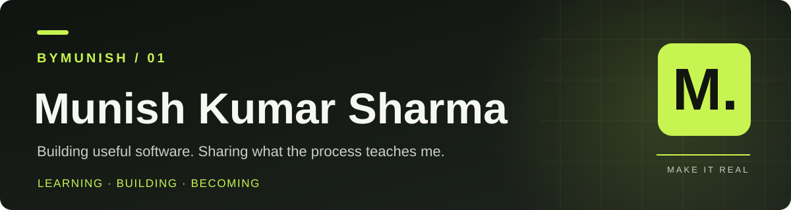

  

  <a href="https://www.youtube.com/@byMunish">YouTube</a> &nbsp;·&nbsp;
  <a href="https://www.instagram.com/by.munish/">Instagram</a> &nbsp;·&nbsp;
  <a href="https://x.com/byMunish">X</a> &nbsp;·&nbsp;
  <a href="https://worldnote.in">WorldNote</a>

---

### A little about me

I'm **Munish Kumar Sharma**. I work on software, digital products, and the less-visible parts of getting an idea out into the world: the decisions, failed attempts, revisions, and small wins.

I'm a co-founder at **[WorldNote](https://worldnote.in)**. Outside work, **byMunish** is where I share what I'm figuring out about technology, entrepreneurship, books, and personal growth.

I like projects that start with a simple question: **_Can this be genuinely useful to someone?_**

### Selected work

| Project | Explore |
| :--- | :--- |
| **WebRun** | [Repository](https://github.com/byMunish/WebRun) |
| **GitGuard** | [Repository](https://github.com/byMunish/GitGuard) |
| **OpenTunnel** | [Repository](https://github.com/byMunish/OpenTunnel) |
| **HexFetch** | [Repository](https://github.com/byMunish/HexFetch) |

*These are a few projects from my GitHub. Check each repository for its current status, documentation, and code.*

### What I work with

**Web** &nbsp; JavaScript · TypeScript · React · Next.js · Tailwind CSS  
**Server & data** &nbsp; Node.js · REST APIs · PostgreSQL · MongoDB  
**Also exploring** &nbsp; Python · AI-assisted development · product thinking

### Currently

- Building and refining digital products with **WorldNote**.
- Improving how I design, develop, and document software.
- Sharing what I learn instead of pretending to have everything figured out.

---

  <strong>Learn something. Build something. Become a little better.</strong> 
  byMunish · Learning. Building. Becoming.

